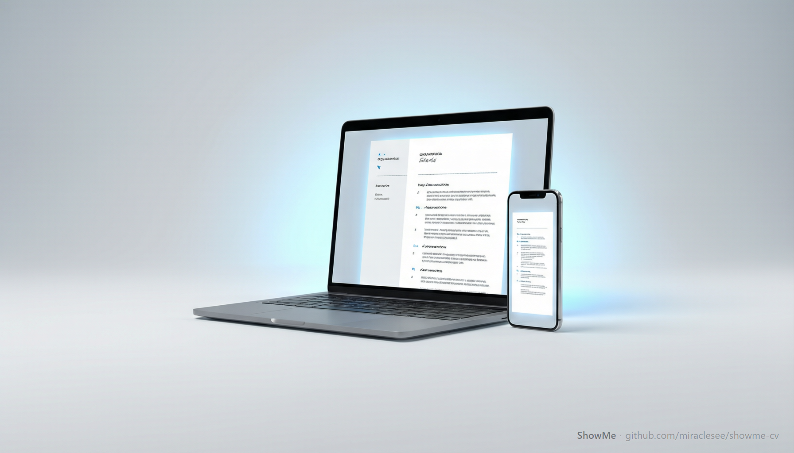
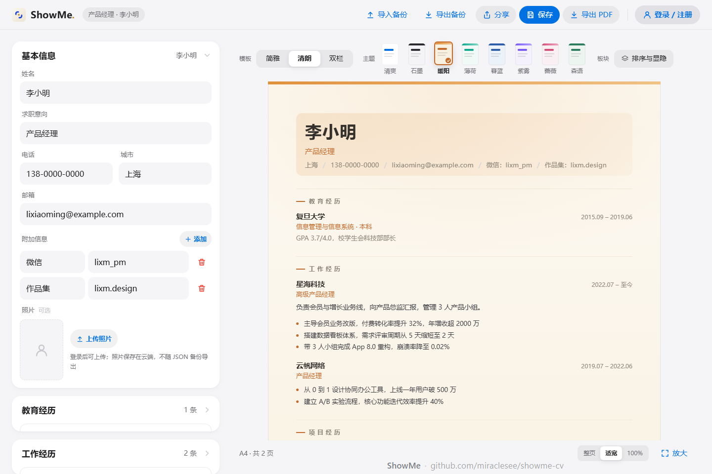
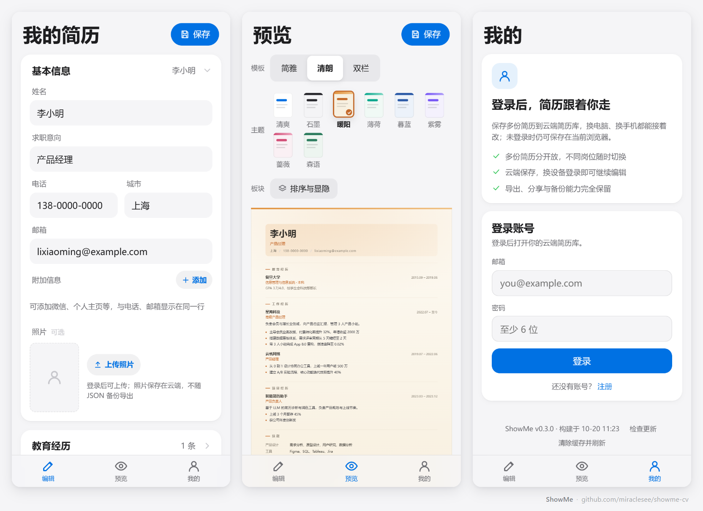

<div align="center">



# ShowMe · 简历网页版

本地优先的在线简历工具：打开就能写，登录后可在云端保存多份简历。

[](https://showme-cv.netlify.app)
[](https://vuejs.org)
[](https://www.typescriptlang.org)
[](https://vitejs.dev)
[](https://supabase.com)

</div>

## 简介

ShowMe 是一款响应式简历工具：电脑上左侧编辑、右侧实时预览，手机上单栏切换编辑、预览与账号。默认数据保存在当前浏览器，无需注册；登录后可将多份简历保存到云端，并随时导出 A4 PDF、Word 或 JSON。

## 功能

- **3 套模板 × 8 种配色**：简雅、清朗、双栏三套 A4 排版，八种主题自由组合，一键切换。
- **灵活的内容结构**：联系方式附加项、项目富文本与要点、自定义模块、板块排序与显隐。
- **可选照片**：登录后上传，自动裁剪为 5:7 并压缩；不上传时不显示占位。
- **全端自适应**：桌面左右双栏，手机单栏 + 底部导航，平板自动限宽居中；PWA 支持离线使用。
- **本地优先，按需上云**：匿名模式只写浏览器本地存储；登录后可保存多份简历，显式保存、状态清晰。
- **分享与接力**：加密短链 / 二维码 7 天有效，可设「仅查看」或「允许编辑」；也支持纯离线长链接。
- **多种导出**：标准 A4 PDF（智能分页）、Word `.docx`、JSON 备份，另提供浏览器打印版。
- **数据边界清晰**：云端简历按用户隔离（RLS）；分享密钥仅置于链接 `#` 之后。

## 界面

桌面端左侧编辑、右侧实时预览；移动端单栏切换编辑、预览与账号。





## 快速开始

要求 Node.js ≥ 22，命令在 `web/` 目录执行：

```bash
cd web
npm install
npm run dev
```

默认以纯本地模式运行。构建与测试：

```bash
npm run build   # 类型检查 + 生产构建
npm test        # 单元测试
```

### 接入云端（可选）

1. 新建 Supabase 项目，在 SQL Editor 中依次执行 `web/db/migrations/` 下的 `0001_resumes.sql`、`0002_multi_resume_profiles.sql`、`0003_resume_photos_storage.sql`。
2. 在 `web/.env.local` 中配置：

   ```bash
   VITE_SUPABASE_URL=https://<project-ref>.supabase.co
   VITE_SUPABASE_PUBLISHABLE_KEY=<publishable-key>
   ```

3. 重新执行 `npm run dev`。

## 常用命令

| 命令 | 作用 |
| :--- | :--- |
| `npm run dev` | 本地开发服务器 |
| `npm run build` | 类型检查 + 构建到 `dist/` |
| `npm test` | 运行单元测试 |
| `npm run typecheck` | 仅做类型检查 |
| `npm run preview` | 预览构建产物 |
| `npm run icons` | 重新生成 PWA 图标 |
| `npm run deploy` | 构建并发布到 Netlify |

## 技术栈

- **前端**：Vue 3 + TypeScript + Vite
- **云端**：Supabase Auth / Postgres（RLS）/ Storage
- **导出**：jsPDF + modern-screenshot（PDF）、docx（Word）
- **分享**：lz-string、qrcode、Web Crypto（AES-GCM）
- **部署与离线**：Netlify Functions + Blobs、vite-plugin-pwa

## 项目结构

```
web/
├── src/                  # 编辑器、预览、导出、云同步、分享
│   └── templates/        # 模板加载、主题目录
├── templates/            # classic / air / duo 三套模板 + 运行时
├── db/migrations/        # Supabase 迁移
├── netlify/functions/    # 短码中转函数
└── server/               # 平台无关的中转业务逻辑
```

## 部署

站点部署在 [Netlify](https://showme-cv.netlify.app)：

```bash
cd web
npm run deploy
```

构建命令为 `npm run build`，发布目录为 `dist`，配置见 `web/netlify.toml`。

## 数据与隐私

- **匿名模式**：简历只保存在当前浏览器，换设备或清理网站数据后不可恢复，请定期导出 JSON 备份。
- **登录模式**：简历写入 Supabase Postgres，按 `user_id` 启用 RLS，只有本人能读写。
- **照片**：上传到公开 Storage 桶，地址包含随机 UUID；JSON 备份只保留路径。
- **分享链接**：加密短链 7 天过期、密钥不发送给服务器；离线长链只做压缩、不加密。「仅查看 / 允许编辑」是界面约束，请只发给信任的人。

---

<div align="center">

如果这个项目对你有帮助，欢迎点个 ⭐。

</div>
