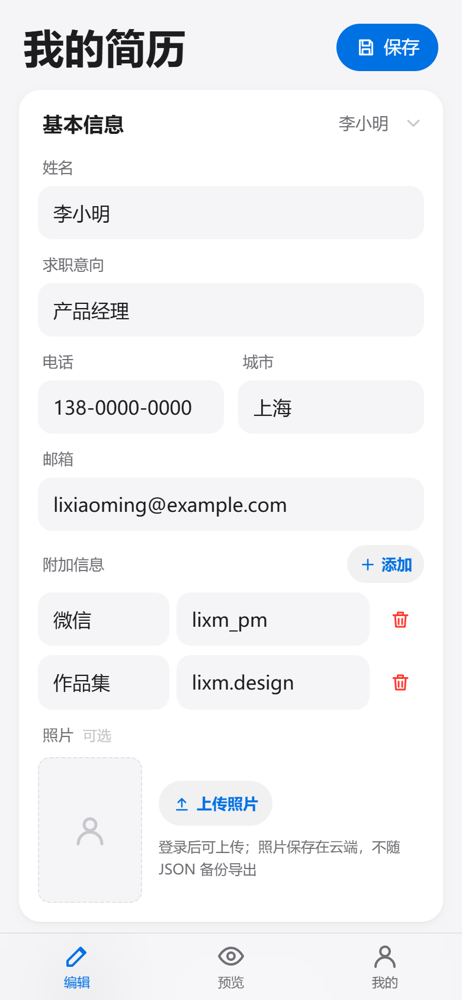

<div align="center">


# ShowMe · 简历网页版

**本地优先的在线简历工具 —— 打开就能写，本地功能无需账号；登录后可在云端保存多份简历。**

[](https://showme-cv.netlify.app)
[](https://vuejs.org)
[](https://www.typescriptlang.org)
[](https://vitejs.dev)
[](https://supabase.com)
[](#-亮点特性)
[](https://www.netlify.com)

</div>

---

ShowMe 是一款响应式简历工具：手机、平板、电脑都能编辑。电脑上左侧改内容、右侧实时看排版，手机上单栏切换编辑与预览。默认数据保存在当前浏览器，无需注册；注册登录后可以把简历存到云端，在多台设备间继续编辑，也可以随时导出 A4 PDF、Word 或 JSON 备份。

## ✨ 亮点特性

| | 特性 | 说明 |
| :---: | :--- | :--- |
| 🎨 | **3 套排版 × 8 种配色** | 简雅 / 清朗 / 双栏三套排版，搭配清爽、石墨、暖阳、薄荷、暮蓝、紫雾、蔷薇、森语八种主题，自由组合一键切换 |
| 🧩 | **不止基础字段** | 联系方式可加「微信 / 作品集」等自定义附加项；项目内容支持富文本与「插入要点」；还可新增任意自定义模块 |
| ↕️ | **板块排序与显隐** | 教育、工作、项目、技能、自定义模块都能上下移动排序，也可以临时隐藏某一块，预览与导出同步生效 |
| 🖼️ | **可选照片** | 登录后上传，自动裁成 5:7 并压缩；不上传时简历完全不显示照片占位 |
| 📱 | **全端自适应** | 手机单栏 + 底部导航（编辑 / 预览 / 我的），电脑左右双栏实时预览，平板自动限宽居中 |
| 💾 | **本地优先，按需上云** | 匿名模式只写浏览器本地存储；登录后可保存多份简历到云端，显式保存、未保存状态一目了然 |
| 🔒 | **数据边界清晰** | 云端简历按用户隔离（Postgres RLS）；分享短链端到端加密，密钥只放在链接 `#` 之后，服务器只见密文 |
| 🔗 | **跨设备接力** | 加密短链 / 二维码 7 天有效，可设「仅查看」或「允许编辑」；也可用纯离线长链接，不依赖服务器 |
| 🖨️ | **多种交付格式** | 一键导出标准 A4 PDF（智能分页）、Word `.docx`、JSON 备份，另提供浏览器打印版 |
| ⚡ | **离线 PWA** | 「添加到主屏幕」后像原生 App 一样启动；断网也能打开和编辑，版本更新有明确提示 |

## 🖼️ 界面一览

**宽屏双栏** —— 左侧块式编辑，右侧所见即所得预览；附加信息、照片、板块管理与账号入口都在同一屏：


**手机窄屏** —— 单栏大标题 + 底部三栏导航，编辑、预览、账号随手切换；保存按钮固定在标题旁：



## 🚀 快速开始

> 环境要求：Node.js ≥ 22。所有命令在项目根目录的 `web/` 下执行。

```bash
cd web
npm install        # 安装依赖
npm run dev        # 本地开发，http://localhost:5173
```

不配置任何云服务时，应用以**纯本地模式**运行：登录入口自动隐藏，简历保存在当前浏览器的 `localStorage`。

### 接入云端（可选）

1. 新建一个 Supabase 项目，在 SQL Editor 中按顺序执行 `web/db/migrations/` 下的迁移：
   - `0001_resumes.sql`：简历表与基础 RLS
   - `0002_multi_resume_profiles.sql`：多简历策略、索引与用户资料表
   - `0003_resume_photos_storage.sql`：照片公开桶与上传策略
2. 在 `web/` 下新建 `.env.local`，填入项目地址与 publishable key：

```bash
VITE_SUPABASE_URL=https://<project-ref>.supabase.co
VITE_SUPABASE_PUBLISHABLE_KEY=<publishable-key>
```

3. 重新执行 `npm run dev`。右上角出现「登录 / 注册」即表示云端已启用。

> 只用本地功能可以跳过这一步。环境文件已被 `.gitignore` 忽略，请不要提交到仓库。

## 🛠️ 常用命令

| 命令 | 作用 |
| :--- | :--- |
| `npm run dev` | 本地开发服务器（内置内存版短码中转） |
| `npm run build` | 类型检查（`vue-tsc`）+ 构建到 `dist/` |
| `npm test` | 运行单元测试（Vitest） |
| `npm run typecheck` | 仅做类型检查 |
| `npm run preview` | 预览构建产物（含 Service Worker），http://localhost:4173 |
| `npm run icons` | 重新生成 PWA 图标 |
| `npm run deploy` | 构建并发布到 Netlify |

## 🧱 技术栈

- **框架**：[Vue 3](https://vuejs.org) + [TypeScript](https://www.typescriptlang.org) + [Vite 7](https://vitejs.dev)
- **云端**：[Supabase](https://supabase.com) Auth + Postgres（RLS）+ Storage
- **离线 / 安装**：[vite-plugin-pwa](https://vite-pwa-org.netlify.app) + Workbox
- **导出**：`jspdf` + `modern-screenshot`（PDF）、`docx`（Word）
- **接力分享**：`lz-string`（离线长链接压缩）+ `qrcode`（二维码）+ 浏览器原生 `Web Crypto`（AES-GCM 加密）
- **短码中转**：Netlify Functions + Netlify Blobs（业务逻辑在 `web/server/relay.ts`）
- **测试**：[Vitest](https://vitest.dev)
- **模板渲染**：三套自包含 HTML 模板（`window.__showme_render` 契约），预览、打印与 PDF 导出共用同一套模板；Word 导出使用同一份简历数据

## 📁 项目结构

```
jianli/
├── web/                          # 网页版主工程
│   ├── src/
│   │   ├── cloud/                # Supabase 客户端、账号、简历库、资料与照片上传
│   │   ├── components/           # 编辑器、预览、分享、账号、板块管理、模板/主题选择器
│   │   ├── export/               # PDF / Word / 下载
│   │   ├── model/                # 简历模型、归一化、板块布局、照片规则
│   │   ├── photo/                # 图片裁剪与压缩
│   │   ├── print/                # 打印版载荷与页面
│   │   ├── relay/                # 接力：加解密、短链、链接解析
│   │   ├── store/                # 简历文档、偏好、备份与本地存储
│   │   ├── templates/            # 模板加载、主题目录、渲染数据
│   │   └── ui/                   # 提示、确认框、文件操作等界面工具
│   ├── templates/                # air / classic / duo 三套模板 + 共享运行时
│   ├── db/migrations/            # Supabase 数据库迁移（简历、资料、照片桶）
│   ├── netlify/functions/        # 短码中转函数（Netlify 适配层）
│   └── server/                   # 平台无关的中转业务逻辑
├── docs/images/                  # 本文档配图
├── openspec/                     # 规格驱动开发文档（proposal / design / specs / tasks）
└── _local/                       # 本地临时文件（不入库）
```

## 🎨 排版 × 主题是怎么解耦的

排版（模板）与配色（主题）互相独立，可任意组合：

- 主题目录集中在 `web/src/templates/themes.ts`，全部视觉都是 **CSS 变量覆盖**，定义在 `web/templates/runtime.css` 的 `html[data-theme=…]` 规则里；
- 渲染数据带可选的模板 / 主题字段，运行时据此切换外观；
- 模板与主题默认是**设备级偏好**，不随 JSON 备份走；分享链接会携带发送方当前的外观，接收方按链接展示，不会改动自己的本地设置。

## 🔐 数据与隐私

- **匿名模式**：简历只保存在当前浏览器的 `localStorage` 中，换浏览器、清理网站数据或无痕模式都会看不到，请定期用「导出备份」保存 JSON。
- **登录模式**：简历写入 Supabase Postgres，按 `user_id` 启用 RLS，只有本人能读写；同一账号可在多台设备上打开自己的简历库。
- **照片**：登录后上传到公开 Storage 桶，地址包含随机 UUID，拿到完整 URL 的人可以查看；JSON 备份只保留路径，不包含图片文件。
- **分享链接**：
  - 加密短链：简历加密后存中转服务，7 天自动过期；密钥只在链接 `#` 之后，不会发送给服务器。
  - 离线长链：整份简历压缩后放在链接 `#` 中，不经过服务器，但链接很长且**只做压缩编码，不做加密**。
  - 「仅查看 / 允许编辑」是界面约束，不是 DRM；拿到链接的人在有效期内都能看到内容，请只发给信任的人。

## 🌐 部署

站点与短码中转一起部署在 **Netlify**：

- 线上地址：<https://showme-cv.netlify.app>
- 一键发布：`cd web && npm run deploy`
- 环境变量：在 Netlify 站点设置中配置 `VITE_SUPABASE_URL`、`VITE_SUPABASE_PUBLISHABLE_KEY`
- 中转接口：`POST /api/relay`（存密文返回短码）、`GET /api/relay/<短码>`（取密文），密文上限 64KB、7 天自动过期
- Git 持续部署：构建命令 `npm run build`，发布目录 `dist`（见 `web/netlify.toml`）

> 若只需要纯静态站点、不要扫码接力，把 `web/dist/` 上传到任意静态托管即可；不配置 Supabase 时自动退回纯本地模式。

---

<div align="center">

**觉得有用？给个 ⭐ 支持一下！**

[▶ 立即体验](https://showme-cv.netlify.app)

</div>
